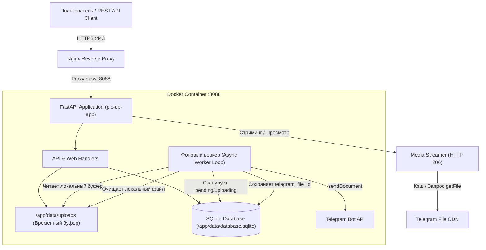
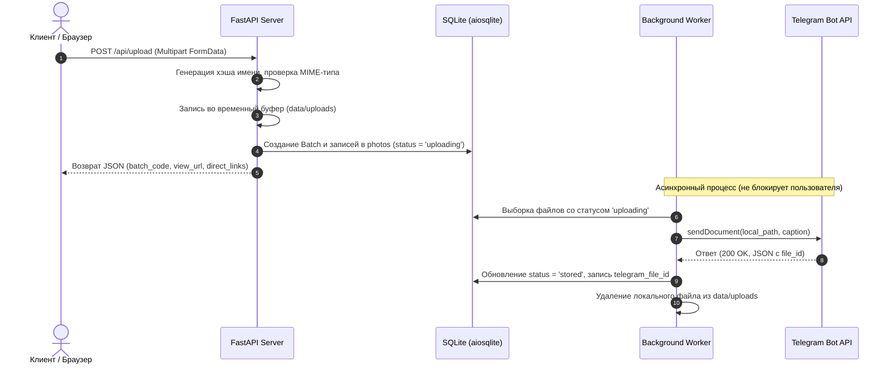

# 📋 Pic-up v2.0 — Архитектурный паспорт и техническая документация

> **Pic-up** — высокопроизводительный асинхронный сервис временного хранения и обмена файлами любого типа с распределенным Telegram-бэкендом хранения, публичным REST API без ключей авторизации и адаптивным Glassmorphism веб-интерфейсом.

---

## 📑 Содержание

1. [Обзор и философия проекта](#1-обзор-и-философия-проекта)
2. [Технический стек](#2-технический-стек)
3. [Архитектура сервиса](#3-архитектура-сервиса)
4. [Telegram Storage Engine](#4-telegram-storage-engine)
5. [Схема базы данных](#5-схема-базы-данных)
6. [Потоковый стриминг (HTTP 206 Range)](#6-потоковый-стриминг-http-206-range)
7. [Спецификация REST API](#7-спецификация-rest-api)
8. [Развертывание и инфраструктура](#8-развертывание-и-инфраструктура)
9. [Конфигурация окружения (.env)](#9-конфигурация-окружения-env)
10. [Диагностика и устранение неполадок](#10-диагностика-и-устранение-неполадок)

---

## 1. Обзор и философия проекта

Pic-up решает ключевую проблему хостинга пользовательских файлов — постоянную нехватку дискового пространства и риск переполнения накопителей сервера. 

Вместо локального хранения гигабайтов медиафайлов архитектура Pic-up использует облачную инфраструктуру Telegram как неограниченное распределенное объектное хранилище:
* При загрузке файл временно сохраняется на диск во временный буфер.
* Пользователь мгновенно получает постоянную ссылку и метаданные подборки (`batch_code`).
* Асинхронный воркер отправляет файл в защищенный Telegram-канал через Telegram Bot API, сохраняет уникальный `telegram_file_id` в локальной базе SQLite и удаляет временный файл с локального диска.
* При запросе файла пользователем сервис запрашивает прямой поток у Telegram CDN через `getFile` и кэширует его локально для повторных быстрых обращений.

---

## 2. Технический стек

| Слой | Технологии | Назначение |
| :--- | :--- | :--- |
| **Backend** | Python 3.11+, FastAPI, Uvicorn, AsyncIO | Высокопроизводительный асинхронный веб-сервер |
| **HTTP Клиент** | HTTPX (AsyncClient) | Асинхронное взаимодействие с Telegram Bot API |
| **Асинхронный I/O** | `aiofiles` | Неблокирующее чтение и запись локальных файлов |
| **База Данных** | SQLite 3, `aiosqlite` | Быстрое встраиваемое асинхронное хранилище метаданных |
| **Шаблонизатор** | Jinja2 | Серверный рендеринг веб-страниц |
| **Архивация & QR** | `zipfile`, `qrcode[pil]` | Генерация ZIP-архивов и QR-кодов на лету |
| **Frontend** | HTML5, CSS3, Vanilla JavaScript (ES6+) | Адаптивный Glassmorphism UI без тяжелых фреймворков |
| **Типографика & Иконки** | Plus Jakarta Sans, JetBrains Mono, SVG | Премиальный дизайн-код Antigravity Design System |
| **Контейнеризация** | Docker, Docker Compose (Alpine base) | Изоляция, масштабируемость и портативность |
| **Веб-сервер / Прокси** | Nginx, Certbot (Let's Encrypt SSL) | SSL-терминация, кэширование статики, защита от атак |

---

## 3. Архитектура сервиса

### Схема компонентов системы



### Жизненный цикл загрузки файла



---

## 4. Telegram Storage Engine

### Универсальное извлечение `file_id`
Telegram Bot API в зависимости от типа загружаемого файла классифицирует его по-разному в объекте `result`:
- MP3 / аудиофайлы возвращаются как `result["audio"]`
- Видеофайлы возвращаются как `result["video"]`
- Документы и архивы возвращаются как `result["document"]`
- Анимации / GIF возвращаются как `result["animation"]`
- Голосовые сообщения возвращаются как `result["voice"]`
- Фотографии возвращаются как массив `result["photo"]` (наилучшее качество — последний элемент)

В `app/telegram.py` реализована устойчивая функция `extract_telegram_file_id()`, выполняющая глубокий поиск `file_id` по всем типам медиа, что предотвращает появление необработанных ответов:

```python
def extract_telegram_file_id(res_data: dict) -> Optional[str]:
    result = res_data.get("result")
    if not isinstance(result, dict):
        return None

    # Проверка прямых медиа-ключей
    for key in ["document", "audio", "video", "animation", "voice", "video_note"]:
        media = result.get(key)
        if isinstance(media, dict) and "file_id" in media:
            return media["file_id"]

    # Проверка массива фото (последнее - самое высокое разрешение)
    photos = result.get("photo")
    if isinstance(photos, list) and len(photos) > 0:
        if isinstance(photos[-1], dict) and "file_id" in photos[-1]:
            return photos[-1]["file_id"]

    # Глубокий рекурсивный поиск
    for val in result.values():
        if isinstance(val, dict) and "file_id" in val:
            return val["file_id"]
    return None
```

### Защита от бесконечных циклов повторной отправки
* Каждая запись в таблице `photos` содержит поле `upload_attempts INTEGER DEFAULT 0`.
* При каждой неудачной попытке отправки вызывается `increment_upload_attempt()`.
* По достижении `upload_attempts >= 3` файл автоматически переводится в статус `failed` и исключается из очереди воркера, гарантируя отсутствие спама в Telegram.

---

## 5. Схема базы данных

База данных SQLite хранится по пути `data/database.sqlite` (внутри контейнера `/app/data/database.sqlite`).

### Таблица `batches` (Подборки)

| Поле | Тип | Описание |
| :--- | :--- | :--- |
| `id` | `INTEGER PRIMARY KEY AUTOINCREMENT` | Внутренний идентификатор подборки |
| `batch_code` | `TEXT UNIQUE NOT NULL` | 16-значный шестнадцатеричный код (`bbe59b7a37327772`) |
| `session_id` | `TEXT` | Идентификатор пользовательской сессии (куки) |
| `created_at` | `TIMESTAMP DEFAULT CURRENT_TIMESTAMP` | Дата и время создания |
| `expires_at` | `TIMESTAMP NOT NULL` | Дата истечения срока хранения |

### Таблица `photos` (Файлы)

| Поле | Тип | Описание |
| :--- | :--- | :--- |
| `id` | `INTEGER PRIMARY KEY AUTOINCREMENT` | Внутренний идентификатор файла |
| `batch_id` | `INTEGER NOT NULL` | Внешний ключ, ссылка на `batches(id)` |
| `original_name` | `TEXT` | Исходное имя файла при загрузке (`track.mp3`) |
| `filename` | `TEXT UNIQUE NOT NULL` | Уникальное имя на сервере (`hash.ext`) |
| `file_type` | `TEXT DEFAULT 'file'` | Категория: `image`, `video`, `audio`, `archive`, `file` |
| `mime_type` | `TEXT` | MIME-тип (`audio/mpeg`, `video/mp4`, `image/webp`) |
| `file_size` | `INTEGER DEFAULT 0` | Размер файла в байтах |
| `local_path` | `TEXT` | Локальный путь в буфере во время загрузки |
| `telegram_file_id` | `TEXT` | Идентификатор файла в облаке Telegram |
| `telegram_file_path` | `TEXT` | Внутренний путь файла на серверах Telegram |
| `status` | `TEXT DEFAULT 'uploading'` | Статус: `uploading`, `stored`, `failed`, `unavailable` |
| `upload_attempts` | `INTEGER DEFAULT 0` | Счётчик попыток синхронизации с Telegram |
| `created_at` | `TIMESTAMP DEFAULT CURRENT_TIMESTAMP` | Дата создания записи |
| `expires_at` | `TIMESTAMP NOT NULL` | Срок жизни файла |
| `ip_address` | `TEXT` | IP-адрес отправителя |

---

## 6. Потоковый стриминг (HTTP 206 Range)

Для аудио- и видеофайлов реализована нативная поддержка стандарта **RFC 7233 (HTTP Range Requests)**:
* Браузер запрашивает заголовки: `Range: bytes=0-1048576`.
* Сервер возвращает статус `206 Partial Content` с заголовками `Content-Range: bytes 0-1048576/15420100` и `Accept-Ranges: bytes`.
* Это обеспечивает мгновенный старт воспроизведения без ожидания полной загрузки файла и плавную перемотку в плеерах HTML5 на смартфонах и десктопах.

---

## 7. Спецификация REST API

Публичный API не требует API-ключей, токенов авторизации или предварительной регистрации.

### Базовые эндпоинты

| Метод | URL | Описание |
| :--- | :--- | :--- |
| `POST` | `/api/upload` | Загрузка одного или нескольких файлов (multipart/form-data) |
| `GET` | `/api/batch/{code}` | Получение метаданных подборки и списка файлов в JSON |
| `GET` | `/api/file/{filename}` | Получение метаданных конкретного файла в JSON |
| `GET` | `/health` | Проверка здоровья сервиса (liveness probe) |
| `GET` | `/i/{filename}` | Прямой просмотр/стриминг файла (raw content) |
| `GET` | `/download/file/{filename}` | Принудительное скачивание с заголовком `Content-Disposition: attachment` |
| `GET` | `/download/?code={batch_code}` | Скачивание всех файлов подборки одним ZIP-архивом |
| `GET` | `/qr/?code={batch_code}` | Генерация QR-кода со ссылкой на подборку |

### Пример ответа `POST /api/upload`:

```json
{
  "success": true,
  "batch_code": "bbe59b7a37327772",
  "view_url": "https://pic-up.ae0.ru/view/?code=bbe59b7a37327772",
  "qr_url": "https://pic-up.ae0.ru/qr/?code=bbe59b7a37327772",
  "download_all_url": "https://pic-up.ae0.ru/download/?code=bbe59b7a37327772",
  "files": [
    {
      "original_name": "presentation.pdf",
      "filename": "deac8ed0ef6e60d341ca6a18a4db5c38.pdf",
      "file_type": "file",
      "mime_type": "application/pdf",
      "size_bytes": 2451020,
      "size_formatted": "2.3 MB",
      "url": "https://pic-up.ae0.ru/i/deac8ed0ef6e60d341ca6a18a4db5c38.pdf",
      "download_url": "https://pic-up.ae0.ru/download/file/deac8ed0ef6e60d341ca6a18a4db5c38.pdf"
    }
  ]
}
```

---

## 8. Развертывание и инфраструктура

### Автоматический скрипт `install.sh`
Проект содержит самодостаточный bash-инсталлятор, позволяющий развернуть работающий сервис с нуля на чистом сервере Ubuntu 22.04 / 24.04:

```bash
git clone https://github.com/GrinRonm/Pic-up /var/www/pic-up.ae0.ru
cd /var/www/pic-up.ae0.ru && bash install.sh
```

**Шаги, выполняемые `install.sh`:**
1. Проверка прав суперпользователя (`root`).
2. Обновление пакетов и установка зависимостей (`curl`, `git`, `sqlite3`, `socat`).
3. Проверка и автоматическая установка Docker и Docker Compose V2.
4. Установка Nginx и Certbot.
5. Настройка reverse proxy с поддержкой WebSocket, увеличенными буферами (`client_max_body_size 100M`) и таймаутами стриминга.
6. Выпуск бесплатного SSL-сертификата Let's Encrypt через Certbot.
7. Проверка конфигурации `.env` (автосоздание из `.env.example`).
8. Сборка Docker-образа и запуск контейнера `pic-up-app` на внутреннем порту `127.0.0.1:8088`.
9. Автоматическая проверка эндпоинта `/health` с выводом статуса.

---

## 9. Конфигурация окружения (.env)

```ini
# Базовый публичный URL сервиса
APP_URL=https://pic-up.ae0.ru

# Внутренний порт приложения
PORT=8088

# Реквизиты Telegram Bot API
TELEGRAM_BOT_TOKEN=7396400534:AAE09x3-7JQpZKeMxPkIAVR1g9F_Hs3_S6c
TELEGRAM_CHAT_ID=-1003724858822

# Ограничения хранилища
MAX_FILES=10
MAX_FILE_SIZE_MB=50
EXPIRY_DAYS=30
```

---

## 10. Диагностика и устранение неполадок

### Полезные команды на сервере

```bash
# Просмотр логов контейнера приложения
docker logs -f --tail 100 pic-up-app

# Перезапуск контейнера
docker restart pic-up-app

# Просмотр состояния файлов в SQLite
sqlite3 /var/www/pic-up.ae0.ru/data/database.sqlite \
  "SELECT id, filename, status, upload_attempts, telegram_file_id FROM photos ORDER BY id DESC LIMIT 10;"

# Проверка статуса Nginx
systemctl status nginx
nginx -t

# Проверка доступности внутреннего порта
curl -I http://127.0.0.1:8088/health
```
