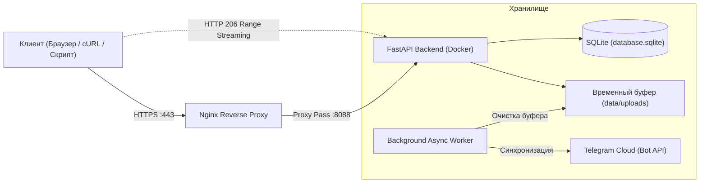

# Pic-up v2.0 🚀

[](https://fastapi.tiangolo.com)
[](https://python.org)
[](https://docker.com)
[](https://telegram.org)
[](https://pic-up.ae0.ru)

**Pic-up** — высокоскоростной сервис временного хранения и обмена файлами любого типа с распределенным Telegram-бэкендом хранения, открытым публичным REST API без ключей и современным стеклянным веб-интерфейсом.

🔗 **Демо-стенд:** [https://pic-up.ae0.ru](https://pic-up.ae0.ru)  
📖 **Документация API:** [https://pic-up.ae0.ru/api/docs](https://pic-up.ae0.ru/api/docs)  
⚡ **Интерактивный Swagger UI:** [https://pic-up.ae0.ru/docs](https://pic-up.ae0.ru/docs)  
📑 **Полный архитектурный паспорт:** [PROJECT.md](PROJECT.md)

---

## ✨ Ключевые возможности

* 📦 **Поддержка любых форматов**: Фото (JPG, PNG, WebP, GIF), Видео (MP4, WebM, MOV, MKV), Музыка (MP3, WAV, FLAC, OGG), Документы (PDF, DOCX, TXT), Архивы (ZIP, RAR, 7Z, TAR), Программы (APK, EXE, DMG).
* ⚡ **Публичный REST API без ключей**: Мгновенная загрузка файлов через cURL, Python, JavaScript, PHP без регистрации и токенов.
* 💬 **Telegram как неограниченное хранилище**: Файлы автоматически выгружаются в приватный Telegram-канал через Bot API, экономя дисковое пространство сервера.
* 🎬 **Потоковый стриминг (HTTP 206 Partial Content)**: Мгновенное воспроизведение тяжелых аудио и видео с плавной перемоткой на мобильных устройствах и ПК.
* 📱 **QR-коды**: Автоматическая генерация QR-кода для мгновенной передачи подборки на смартфон.
* 🗜️ **Скачивание архивом (ZIP)**: Скачивание всей пачки файлов одним кликом.
* 🎨 **Премиальный UI/UX**: Адаптивный дизайн в стиле Antigravity Glassmorphism, сетка Bento Grid, шрифты Plus Jakarta Sans + JetBrains Mono, 100% векторные SVG-иконки, полноэкранный Lightbox.
* 🐳 **Полная контейнеризация**: Готовый Dockerfile и docker-compose конфигурация.
* 🛠️ **Автоматический инсталлятор `install.sh`**: Развертывание всего стека (Docker, Nginx, Let's Encrypt SSL, App) в одну команду на чистой Ubuntu.

---

## 🏗️ Архитектура системы



---

## 🚀 Быстрый старт на чистом сервере Ubuntu

Для полного развертывания проекта на чистом сервере (Ubuntu 22.04 / 24.04) выполните:

```bash
git clone https://github.com/GrinRonm/Pic-up /var/www/pic-up.ae0.ru
cd /var/www/pic-up.ae0.ru && bash install.sh
```

**Что делает `install.sh` сам:**
1. Проверяет наличие и устанавливает `docker`, `docker-compose`, `nginx`, `certbot`.
2. Настраивает виртуальный хост Nginx с правильными буферами, таймаутами и поддержкой стриминга.
3. Выпускает бесплатный SSL-сертификат Let's Encrypt.
4. Создает файл `.env` из примера.
5. Запускает контейнер `pic-up-app` и проверяет здоровье по `/health`.

---

## 📡 Публичный REST API

Базовый URL: `https://pic-up.ae0.ru/api`

### 1. Загрузка файлов (`POST /api/upload`)

#### cURL:
```bash
# Один файл
curl -X POST "https://pic-up.ae0.ru/api/upload" \
  -F "file=@document.pdf"

# Несколько файлов за один запрос
curl -X POST "https://pic-up.ae0.ru/api/upload" \
  -F "files=@photo.jpg" \
  -F "files=@song.mp3" \
  -F "files=@video.mp4"
```

#### Python:
```python
import requests

url = "https://pic-up.ae0.ru/api/upload"
files = [
    ("files", ("video.mp4", open("video.mp4", "rb"), "video/mp4")),
    ("files", ("notes.txt", open("notes.txt", "rb"), "text/plain"))
]
response = requests.post(url, files=files)
data = response.json()

print(f"Ссылка на просмотр: {data['view_url']}")
print(f"Прямая ссылка на файл: {data['files'][0]['url']}")
```

#### JavaScript (Fetch):
```javascript
const formData = new FormData();
formData.append('files', fileInput.files[0]);

const response = await fetch('https://pic-up.ae0.ru/api/upload', {
  method: 'POST',
  body: formData
});
const data = await response.json();
console.log('Подборка готова:', data.view_url);
```

#### Пример ответа API (JSON):
```json
{
  "success": true,
  "batch_code": "bbe59b7a37327772",
  "view_url": "https://pic-up.ae0.ru/view/?code=bbe59b7a37327772",
  "qr_url": "https://pic-up.ae0.ru/qr/?code=bbe59b7a37327772",
  "download_all_url": "https://pic-up.ae0.ru/download/?code=bbe59b7a37327772",
  "files": [
    {
      "original_name": "song.mp3",
      "filename": "9e901c6f2d50257d2f2c95b9dc145ed0.mp3",
      "file_type": "audio",
      "mime_type": "audio/mpeg",
      "size_bytes": 4821040,
      "size_formatted": "4.6 MB",
      "url": "https://pic-up.ae0.ru/i/9e901c6f2d50257d2f2c95b9dc145ed0.mp3",
      "download_url": "https://pic-up.ae0.ru/download/file/9e901c6f2d50257d2f2c95b9dc145ed0.mp3"
    }
  ]
}
```

### 2. Информация о подборке (`GET /api/batch/{code}`)
Возвращает список всех файлов в батче, статус каждого файла (`stored`, `uploading`), размер и прямые ссылки.

### 3. Информация о файле (`GET /api/file/{filename}`)
Возвращает метаданные конкретного файла по его хэш-имени.

---

## ⚙️ Переменные окружения (.env)

| Переменная | По умолчанию | Описание |
|---|---|---|
| `APP_URL` | `https://pic-up.ae0.ru` | Публичный корневой URL сервиса |
| `PORT` | `8088` | Внутренний порт приложения внутри Docker |
| `TELEGRAM_BOT_TOKEN` | — | Токен бота от [@BotFather](https://t.me/BotFather) |
| `TELEGRAM_CHAT_ID` | — | ID приватного канала-хранилища |
| `MAX_FILES` | `10` | Максимальное количество файлов в одной пачке |
| `MAX_FILE_SIZE_MB` | `50` | Лимит размера одного файла (МБ) |
| `EXPIRY_DAYS` | `30` | Срок хранения файлов (дней) |

---

## 🛠️ Управление контейнером Docker

```bash
# Просмотр логов сервиса в реальном времени
docker compose logs -f

# Перезапуск сервиса
docker compose restart

# Остановка контейнера
docker compose down

# Пересборка и запуск в фоновом режиме
docker compose up -d --build
```

---

## 📄 Лицензия

Проект распространяется под свободной лицензией **MIT**. Подробная архитектура и технические детали описаны в файле [PROJECT.md](PROJECT.md).
